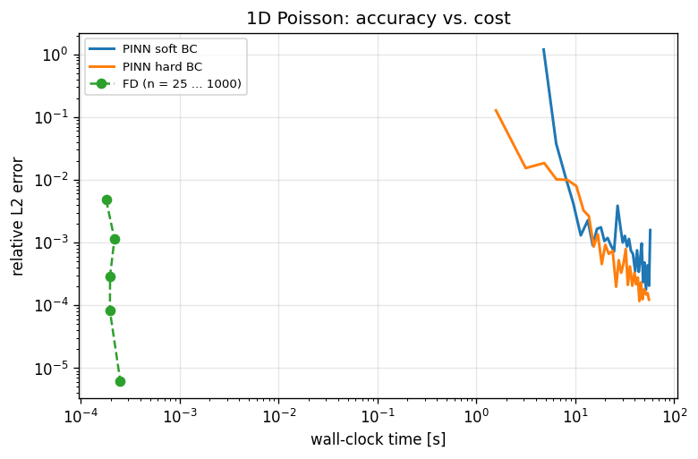
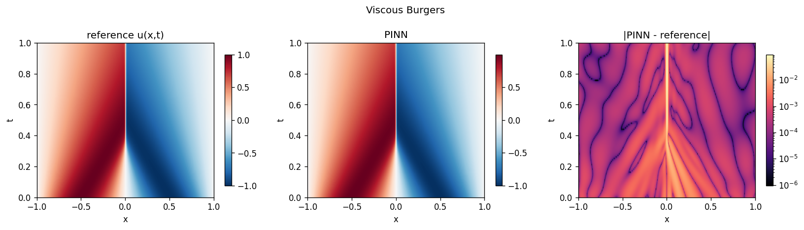
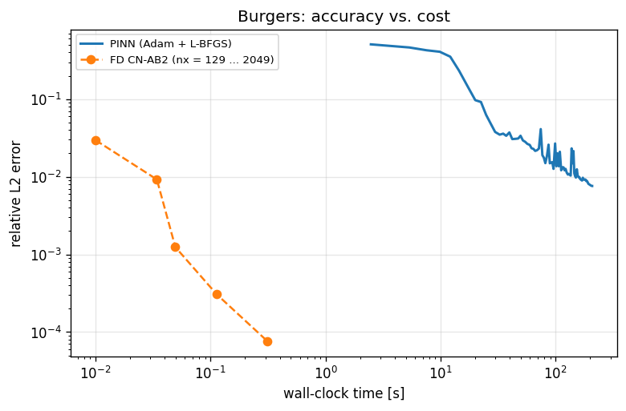
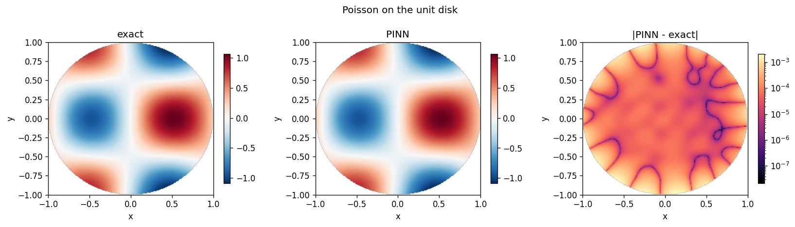
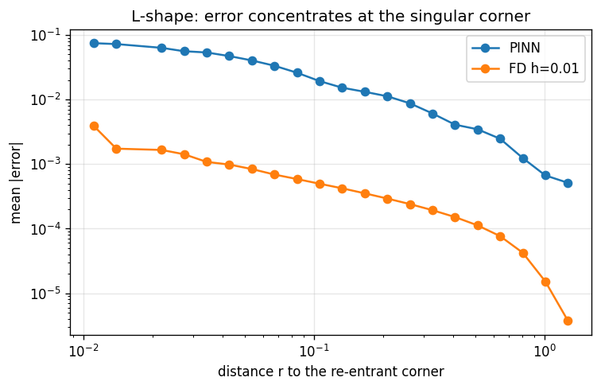
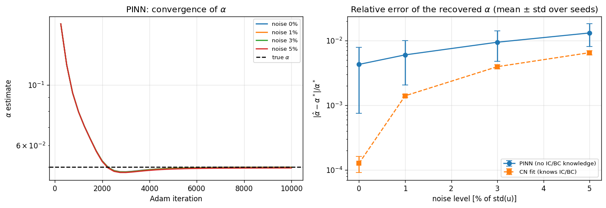
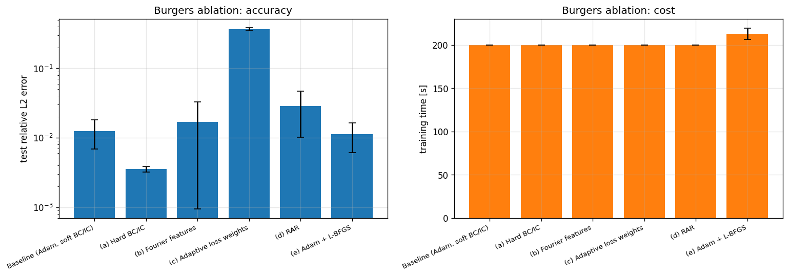
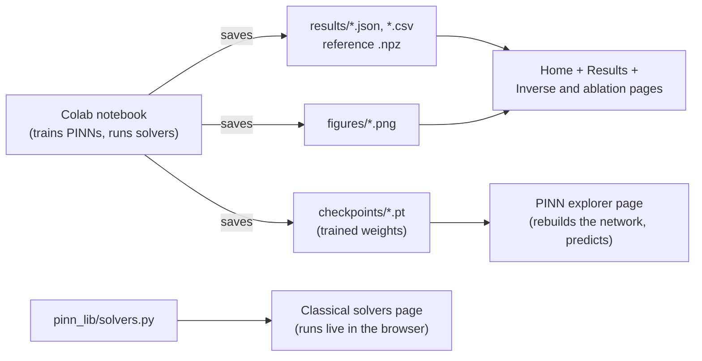

# When do PINNs work?

### Physics-Informed Neural Networks vs. classical numerical solvers, with an interactive Streamlit dashboard

This project asks one question and answers it with experiments:

> **If you need to solve a physics equation, should you use a neural network (a PINN) or a traditional numerical method?**

Short answer, from the experiments in this repo: **for ordinary forward problems, the traditional method wins by a wide margin** (thousands of times faster at the same accuracy). PINNs are competitive in a few specific situations, mainly when you have to *discover an unknown parameter from messy data* or when the *shape of the domain* is awkward. The details, numbers and caveats are below.

You do not need a maths or machine-learning background to follow this README. Words in *italics* are explained in the [glossary](#glossary).

---

## Contents

1. [The 60-second summary](#the-60-second-summary)
2. [Background in plain English](#background-in-plain-english)
3. [What was tested (the six experiments)](#what-was-tested-the-six-experiments)
4. [Results](#results)
5. [What the results mean](#what-the-results-mean)
6. [How the comparison was kept fair](#how-the-comparison-was-kept-fair)
7. [How the dashboard works](#how-the-dashboard-works)
8. [Project structure](#project-structure)
9. [Run it](#run-it) (locally or on Streamlit Cloud)
10. [Reproduce or replace the results](#reproduce-or-replace-the-results)
11. [Limitations (please read)](#limitations-please-read)
12. [FAQ and troubleshooting](#faq-and-troubleshooting)
13. [Glossary](#glossary)
14. [References](#references)

---

## The 60-second summary

| Question | Answer from this project |
|---|---|
| Is a PINN more accurate than a classical solver? | Rarely. On 4 of 5 forward problems a classical solver reached the PINN's accuracy **thousands of times faster** (4,000x to 280,000x). |
| Is there any forward problem where the PINN looked better? | Yes, **one**: the unit disk, where the PINN was ~11x more accurate than the (deliberately simple, first-order) finite-difference solver we compared against. A better classical method would likely close this gap; that was not tested. |
| Where did the PINN clearly struggle? | At sharp features: the **shock** in the Burgers equation and the **corner singularity** of the L-shaped domain. |
| Where is a PINN genuinely useful? | **Inverse problems**: it recovered an unknown physical constant to within about 1% from noisy data *without being told the starting or boundary conditions*. |
| What improved the PINN the most? | Building the boundary conditions into the network's structure ("hard constraints"): 3.5x to 13x lower error, depending on the experiment, at no extra cost. |
| What hurt? | One type of automatic loss re-weighting made the Burgers PINN ~29x **worse** in this setup. |

---

## Background in plain English

### What is a "physics equation" (PDE) here?
Many things in nature are described by *partial differential equations (PDEs)*: how heat spreads through a metal rod, how a shock wave forms in a fluid, how an electric field sits inside a shaped region. Given the equation plus starting and boundary conditions, "solving" it means finding the quantity (temperature, velocity, ...) at every point in space and time.

### Classical solvers
The traditional approach chops space and time into a grid and turns the equation into arithmetic on that grid (*finite differences*, *Crank-Nicolson*, *spectral methods*). It has been refined for decades: it is **fast, predictable, and gets more accurate in a known way when you refine the grid**.

### PINNs
A *Physics-Informed Neural Network* is a neural network `u(x, t)` that takes a position and time and outputs the answer. Instead of being trained on labelled examples, it is trained to **make the physics equation true**: at thousands of random points the network is penalised if its output does not satisfy the equation, the starting condition or the boundary condition. No grid and no mesh are needed. The appeal is flexibility; the cost is that "training" is a slow, noisy optimisation that can get stuck.

### Why compare them honestly?
Many papers show PINNs against weak or untuned classical methods. Here, both sides are tested on the **same equations, same test points, same exact answer**, and cost (seconds of computing) is reported next to accuracy.

---

## What was tested (the six experiments)

| # | Problem | In plain words | Why it was chosen |
|---|---|---|---|
| 1 | **1D Poisson** | Find a smooth curve whose curvature is prescribed and which is zero at both ends | The easiest case: a sanity check that the pipeline works. Also compares "soft" and "hard" boundary conditions. |
| 2 | **1D heat equation** | How a temperature pattern along a rod fades over time | A standard time-dependent problem; classical methods FTCS and Crank-Nicolson are the competitors. |
| 3 | **Viscous Burgers equation** | A wave that steepens into a very thin shock | The classic *hard* case for PINNs: a sharp feature that smooth networks find difficult. A spectral solver provides a near-exact reference. |
| 4a | **Poisson on a unit disk** | Same type of problem, but on a circular region | Shows the PINN's "mesh-free" convenience: a curved boundary is easy for it and awkward for grid methods. |
| 4b | **Laplace on an L-shaped region** | The same, on an L-shaped region whose inner corner makes the solution change very sharply | An honest **failure case**: the exact solution has an unbounded slope at the corner. |
| 5 | **Inverse problem** | Given noisy temperature readings at scattered points, recover the unknown heat-diffusion constant (true value 0.05) | The setting where PINNs are most often recommended. |
| 6 | **Ablation study on Burgers** | Turn individual PINN "tricks" on one at a time and see what helps | Separates what matters from what is folklore. |

---

## Results

All numbers below come from the **full-mode** run on a GPU (`results_full_gpu.*`, included in `data/results/`). "Error" means *relative L2 error*: roughly "how far off is the answer, as a fraction of its size" (0.01 = 1% off). Lower is better.

### Headline: PINN vs. classical, forward problems

| Experiment | Best PINN error | PINN training time | Best classical error | Cheapest classical run that was **at least as accurate as the PINN** | How much faster |
|---|---|---|---|---|---|
| 1. Poisson 1D | 1.2e-4 (hard BC) | 55 s | 6.2e-6 | finite differences, 200 intervals: 0.0002 s | **~280,000x** |
| 2. Heat 1D | 4.9e-5 | 159 s | 5.3e-6 | Crank-Nicolson, 200 intervals: 0.0135 s | **~11,800x** |
| 3. Burgers | 7.6e-3 | 208 s | 7.6e-5 | finite differences, 513 points: 0.05 s | **~4,200x** |
| 4a. Disk | 5.8e-4 | 153 s | 6.4e-3 | *none of the grids tried reached it* | PINN more accurate |
| 4b. L-shape | 8.6e-3 | 147 s | 2.4e-4 | finite differences, h = 2/20: 0.002 s | **~70,600x** |

*(Timing note: PINN time is optimisation only; classical time is the best of up to 3 repeats. The PINN ran on a GPU and the classical solvers on a CPU, which if anything favours the PINN.)*

### Experiment 1: 1D Poisson (pipeline check)

Both PINNs solved it, so the code works. Putting the boundary conditions into the network's structure ("hard BC") gave **1.2e-4** error versus **1.6e-3** with the usual penalty approach (soft BC), about 13x better at the same cost. A trivial finite-difference solve with 200 intervals matched the hard-BC PINN in **0.2 milliseconds**.



*Reading the plot: lower-left is better. The green classical points sit far to the left of the PINN curves, i.e. they are many orders of magnitude cheaper.*

### Experiment 2: 1D heat equation

The hard-constraint PINN reached 4.9e-5, about the accuracy of a Crank-Nicolson solver with 100 to 200 intervals (7 to 14 ms). Crank-Nicolson at 400 intervals reached 5.3e-6 in 28 ms. The older explicit method (FTCS) is also quick here, but needs ever smaller time steps as the grid is refined.

### Experiment 3: Burgers equation (the shock)

The PINN captured the overall wave (7.6e-3 error) but the **error concentrates in the thin shock at x = 0** (bright vertical line in the right-hand panel) and in a fan-shaped band at early times.





*Reading the plot: the finite-difference solver (orange) reaches 100x lower error than the PINN (blue) in 0.3 s, while the PINN needs ~200 s just to get to 1e-2.* A coarse 257-point finite-difference grid (0.03 s) already gets a similar error (9e-3).

### Experiment 4: irregular shapes

* **Disk (PINN wins on accuracy).** Using only random points inside and on the circle, the PINN reached 5.8e-4. The finite-difference baseline uses a "staircase" approximation of the curved edge, which is only first-order accurate, so its best error was 6.4e-3. The PINN's own error is largest right at the boundary (soft boundary penalty).
  Caveat: the baseline here is intentionally simple. Boundary-fitted finite differences or finite elements are better, and were not tried.

  

* **L-shape (PINN fails).** The PINN error is largest at the re-entrant corner and decays away from it; finite differences are also worst there but are far more accurate overall (2.4e-4 vs 8.6e-3).

  

### Experiment 5: inverse problem (recover the diffusion constant)

The true value is **0.05**. The PINN started from a deliberately wrong guess of 0.2 and converged to the right value (about 0.05) after roughly 4,000 to 5,000 training steps at every noise level.



| Noise in the data | PINN error in the constant (mean of 2 seeds) | Classical least-squares fit (told the starting/boundary conditions) |
|---|---|---|
| 0% | 0.43% | 0.01% |
| 1% | 0.60% | 0.14% |
| 3% | 0.94% | 0.39% |
| 5% | 1.30% | 0.65% |

* The PINN lands within about **1%** and gets slightly worse as noise increases, as it should.
* The classical fit is more accurate and ~1,000x faster (0.1 s vs ~95 s) **but it was given extra information** (the exact initial and boundary conditions). The PINN was not. That is its real selling point: it works with less prior knowledge.

### Experiment 6: ablation on Burgers (which tricks help?)

Each variant changes **one** thing from a baseline PINN. All Adam runs were limited to 200 seconds; two seeds each.



| Variant | Mean error | vs. baseline | Verdict |
|---|---|---|---|
| Baseline (soft BC/IC, Adam) | 1.25e-2 | 1.00x | reference |
| (a) **Hard BC/IC** | **3.5e-3** | **0.28x** | **Clearly better**: both seeds beat both baseline seeds |
| (b) Fourier features | 1.7e-2 | 1.35x | Inconclusive (very large seed-to-seed spread) |
| (c) Adaptive loss weights | 3.6e-1 | 29x | **Clearly worse** in this setup |
| (d) Residual-based refinement (RAR) | 2.8e-2 | 2.3x | Inconclusive; if anything worse |
| (e) Adam + L-BFGS | 1.1e-2 | 0.90x | Inconclusive; within noise of the baseline |

With only two seeds and large run-to-run variation (the baseline alone ranged from 8.5e-3 to 1.7e-2), **only the "clearly better/worse" rows should be trusted.** In particular, (c) failing here says that *this implementation with these settings* failed, not that adaptive weighting never works. The cause was not investigated.

---

## What the results mean

1. **For a normal forward problem, use a classical solver.** It was 4,000x to 280,000x cheaper at equal accuracy, and its accuracy improves predictably when you refine the grid. A PINN's accuracy depends on how well an optimiser happened to do.
2. **A PINN's weak spots are sharp features.** Shocks and corner singularities are where it was least accurate, and where classical methods have well-known fixes.
3. **Build the constraints into the network when you can.** Hard boundary conditions were the single most reliable improvement we measured, and cost nothing.
4. **PINNs earn their keep in inverse and "messy-geometry" problems.** One piece of code recovered the unknown constant from noisy data without the starting or boundary conditions. For awkward shapes, you only change how points are sampled, not build a mesh.
5. **Treat PINN tuning tricks sceptically.** Several popular tricks did not help here and one hurt badly. Test them on your own problem, with several seeds.

---

## How the comparison was kept fair

* **Same test points, same exact answer.** Every method, PINN or classical, is scored on the same fixed grid, against the exact solution (or, for Burgers, a high-accuracy spectral solution computed in the notebook with 2,048 modes). The test points are never used for training.
* **Cost is reported.** PINN time counts only optimisation (not logging/plotting). Classical time is the best of up to 3 repeats.
* **Sanity checks before any training.** The notebook checks its derivative code and every equation's residual against exact solutions; if a check fails, it stops.
* **Failures are recorded, not hidden.** If any step failed, it appears in the results table instead of crashing the run. (In the included run: 0 failures.)
* **Time-capped runs are flagged.** Ten Burgers ablation runs hit their 200-second limit before finishing all 20,000 Adam steps (they stopped at about 14,500 to 18,500 steps). Their errors are *budget-limited*, not fully converged.

---

## How the dashboard works

The project has two halves:

1. **The notebook (`pinn_project.ipynb`, run once in Google Colab)** does the heavy work: trains the PINNs, runs the classical solvers, and saves everything to disk.
2. **The Streamlit dashboard (this folder)** displays those saved results and lets you explore them interactively. It does **not** retrain anything.



### The pages

| Page | What you can do |
|---|---|
| **Home** | See the headline PINN-vs-classical comparison and whether data, checkpoints and PyTorch were found. |
| **Results** | Browse and filter the full results table, download it as CSV, see accuracy-vs-cost plots per experiment, and view the notebook's figures. |
| **Classical solvers** | Run the finite-difference, Crank-Nicolson and spectral solvers **live**. Slide the grid size and watch the error, runtime and plots change; tick "Convergence table" to see error vs. grid size. |
| **PINN explorer** | Pick a trained network. The app rebuilds it from the saved weights, evaluates it on the test grid, and shows prediction vs. exact/reference solution, the error map, and the training curves. |
| **Inverse and ablation** | Recovery of the diffusion constant vs. noise level, and the Burgers ablation with error bars and "versus baseline" ratios. |

### Where each number comes from

* **Results, Home, Inverse and ablation:** read from `data/results/results_<run>.json`. They were computed by the notebook.
* **Classical solvers page:** computed fresh in your browser session using the same code and test grids as the notebook.
* **PINN explorer:** computed fresh from the saved weights. Its error for a run should match that run's value in the table.

### How the explorer rebuilds a network from a checkpoint

A checkpoint stores the weights and training history but not the network design. The app infers the design from the weight shapes (width, depth, whether Fourier features were used) and picks the right "hard constraint" output layer from the file name (`poisson_hard...`, `heat_hard...`, `burgers_hard_bc...`). That is why the notebook's file names must be kept unchanged.

---

## Project structure

```
pinn_dashboard/
├── app.py                         # Home page (entry point for Streamlit)
├── pages/
│   ├── 1_Results.py               # results table, accuracy-vs-cost, figures
│   ├── 2_Classical_Solvers.py     # live classical solvers
│   ├── 3_PINN_Explorer.py         # load and evaluate trained checkpoints
│   └── 4_Inverse_and_Ablation.py  # experiments 5 and 6
├── pinn_lib/                      # code shared by the pages (extracted from the notebook)
│   ├── pdes.py                    # exact solutions, test grids, domain masks
│   ├── solvers.py                 # FD, Crank-Nicolson, FTCS, spectral, masked-grid solvers
│   ├── metrics.py                 # relative L2 and max error
│   ├── plots.py                   # figure builders
│   ├── data.py                    # reads results / checkpoints / figures; builds summary tables
│   ├── torch_model.py             # rebuilds PINNs from checkpoints (needs PyTorch)
│   └── ui.py                      # small Streamlit helpers (sidebar etc.)
├── data/                          # the notebook's outputs (already included from your run)
│   ├── results/                   # results_full_gpu.json/.csv, findings_full_gpu.txt, burgers_reference_N2048.npz
│   ├── checkpoints/               # 25 trained networks (*.pt)
│   └── figures/                   # 16 notebook figures (*.png)
├── tests/smoke_test.py            # quick check of the numerical code
├── requirements.txt
├── .streamlit/config.toml
└── README.md
```

---

## Run it

### Option A: deploy on Streamlit Community Cloud (free)

1. Create a GitHub repository and upload the **contents of this folder** (so `app.py` is at the top level).
2. Go to <https://share.streamlit.io>, sign in with GitHub, click **New app**.
3. Choose your repository and branch, set **Main file path** to `app.py`, and click **Deploy**.
4. The first build takes a few minutes (it installs PyTorch). Afterwards the app opens at a public URL.

Tips: under *Advanced settings* choose Python 3.11 or 3.12. If the build is too slow or runs out of space, delete the `torch` lines in `requirements.txt`; everything except the PINN explorer page still works.

### Option B: run on your own computer

```bash
pip install -r requirements.txt
streamlit run app.py
```

Then open the address it prints (normally <http://localhost:8501>).

Alternatively view the project site: <https://nexuspinn-pde.streamlit.app/>

### Quick self-test (no Streamlit or PyTorch needed)

```bash
python tests/smoke_test.py      # prints "smoke test OK"
```

---

## Reproduce or replace the results

The included results come from one **full-mode** run (`full_gpu`). To make your own:

1. Open `pinn_project.ipynb` in Google Colab and choose **Runtime → Change runtime type → T4 GPU**.
2. In the configuration cell set `QUICK_MODE = False` (full, up to ~90 minutes) or `True` (quick, up to ~30 minutes), plus `USE_DRIVE = True` so files survive disconnects.
3. **Runtime → Run all.** If the session drops, run all again: finished runs are reloaded from their checkpoints and interrupted runs resume.
4. Download `pinn_project/results`, `checkpoints` and `figures` from Google Drive and copy them into `data/` (see `data/README.md`).
5. Restart/redeploy the app. The sidebar lists every run found (`quick_gpu`, `full_gpu`, ...). You can also **upload a results file or a single checkpoint directly in the sidebar** without redeploying.

Run names: results are `results_<TAG>.json`, checkpoints `<run>__<TAG>.pt`, figures `<name>_<TAG>.png`, where `<TAG>` is `quick`/`full` + `gpu`/`cpu`.

---

## Limitations (please read)

* **Training budgets limit the PINNs.** All PINNs have a fixed training budget; the ten Burgers ablation runs hit their time cap, so their errors are not fully converged. A longer or better-tuned run could do better.
* **Few seeds.** The ablation and inverse experiments use only 2 random seeds, and the forward experiments use 1. Differences smaller than roughly 2x between PINN variants are not reliable.
* **Simple classical baselines.** The classical solvers are deliberately basic (uniform grids, no adaptivity, a first-order staircase on the disk). Stronger classical methods (finite elements with mesh refinement, boundary-fitted grids, high-order methods) would widen the gap on forward problems, and could also overturn the disk result.
* **Light tuning.** Hyper-parameters (learning rate, network size, penalty weights) were reasonable defaults, not tuned per problem, for both PINNs and classical solvers.
* **Hardware.** The PINNs ran on a GPU; the classical solvers on a CPU. This favours the PINN, so the real gap is, if anything, larger.
* **Small problems only.** These are 1D and 2D textbook problems. PINNs may do relatively better on high-dimensional or parametric problems, where grid methods become impractical. That is not tested here.
* **Single reference for Burgers.** The "exact" answer for Burgers is a high-accuracy numerical solution (checked against a 1,024-mode run in the notebook), not a closed-form formula.
* **Adaptive weights result.** The 29x worse result for adaptive weighting is specific to this implementation and these settings; the cause was not investigated.

---

## FAQ and troubleshooting

**Does the dashboard train a model?**
No. It displays results and trained networks produced by the notebook. The only things it computes live are the classical solvers and the evaluation of saved networks.

**The "PINN explorer" page says PyTorch is not installed.**
Add `torch` (CPU build) to `requirements.txt` and redeploy. The line `--extra-index-url https://download.pytorch.org/whl/cpu` there makes the install smaller.

**The explorer says "Don't know how to evaluate runs named ...".**
The checkpoint file name was changed. Use the original name pattern, e.g. `heat_hard_s1234__full_gpu.pt`.

**The first load of the Classical solvers page is slow.**
Some solvers (finest grids, the live Burgers reference if the `.npz` is missing) take a few seconds. Results are cached afterwards.

**No data shows up.**
Check that `data/results/results_<TAG>.json` exists, or upload the file in the sidebar.

**Can I trust a single number in the table?**
Treat PINN numbers as "what this network reached in this training budget with this seed", not as the best the method can do. Prefer patterns across experiments over single values.

**Is it safe to upload checkpoints?**
Checkpoint files use Python's pickle format, which can run code when loaded. Only load files you created yourself.

---

## Glossary

* **PDE (partial differential equation):** an equation that links how a quantity changes in space and in time, such as heat flow or fluid motion.
* **Boundary condition (BC) / initial condition (IC):** the values the answer must take at the edges of the region and at the starting time.
* **PINN:** a neural network trained so that its output obeys a PDE and its BC/IC, using the equation itself as the training signal.
* **Soft vs. hard boundary conditions:** *soft* = the network is penalised when it breaks the BC; *hard* = the network's formula is built so that the BC is satisfied exactly.
* **Finite differences:** replace derivatives by differences between neighbouring grid values.
* **Crank-Nicolson / FTCS:** two time-stepping schemes for the heat equation (the first is stable for any step size, the second needs very small steps).
* **Spectral method:** represents the solution with waves (Fourier series); extremely accurate for smooth problems. Used here as the Burgers reference.
* **Relative L2 error:** overall size of the difference between an answer and the truth, divided by the size of the truth (0.01 means about 1% off).
* **Collocation points:** the random points where a PINN is asked to satisfy the equation.
* **Adam / L-BFGS:** two optimisation algorithms used to train the network (Adam is robust and slow; L-BFGS is a sharper "polishing" step).
* **Fourier features:** a way of feeding the network sine/cosine versions of its inputs to help it learn rapid wiggles.
* **RAR (residual-based adaptive refinement):** add more training points where the equation is currently most violated.
* **Adaptive loss weights:** automatically re-balance the different penalty terms during training.
* **Ablation study:** remove or add one ingredient at a time to see its effect.
* **Inverse problem:** find the unknown constant (or source) in an equation from measurements of its solution.
* **Seed:** the number that fixes random choices, so a run can be repeated. Several seeds show how much results vary by chance.
* **Checkpoint:** a saved copy of a trained network's weights.

---

## References

1. M. Raissi, P. Perdikaris, G. E. Karniadakis (2019). *Physics-informed neural networks.* J. Comput. Phys. 378, 686-707.
2. S. Wang, Y. Teng, P. Perdikaris (2021). *Understanding and mitigating gradient flow pathologies in PINNs.* SIAM J. Sci. Comput. 43(5).
3. L. Lu, X. Meng, Z. Mao, G. E. Karniadakis (2021). *DeepXDE.* SIAM Review 63(1) (source of RAR).
4. M. Tancik et al. (2020). *Fourier features let networks learn high frequency functions.* NeurIPS.
5. A.-K. Kassam, L. N. Trefethen (2005). *Fourth-order time-stepping for stiff PDEs.* SIAM J. Sci. Comput. 26(4).
6. T. G. Grossmann et al. (2024). *Can physics-informed neural networks beat the finite element method?* IMA J. Appl. Math.
7. N. McGreivy, A. Hakim (2024). *Weak baselines and reporting biases lead to overoptimism in ML for fluid-related PDEs.* Nature Machine Intelligence.
